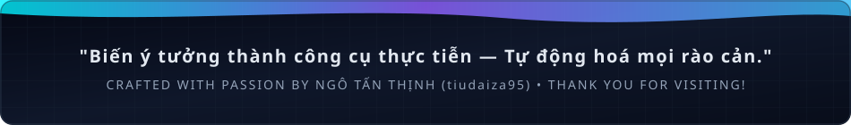

<!-- HEADER BANNER AREA -->

  

<!-- TYPING ANIMATION & INTRO -->

  

   

  <!-- BADGES / PROFILE STATS -->
  

    
    
    
    
    
  

 

<!-- NEON ANIMATED DIVIDER -->

 

<!-- ABOUT ME -->
<table border="0">
  <tr>
    <td width="62%" valign="top">
      <h3>👨‍💻 Về Ngô Tấn Thịnh (About Me)</h3>
      

        Xin chào! Mình là <b>Ngô Tấn Thịnh</b> (thường được biết đến với nickname <b>tiudaiza95</b>) — một người say mê <b>tự động hoá thông minh, chế tạo công cụ phần mềm</b> và tối ưu hoá hiệu năng máy tính. Mình luôn tìm kiếm những cách tân tiến nhất để biến những quy trình thủ công phức tạp thành những giải pháp 1-click mượt mà, tốc độ và tiện ích cho người dùng.
      

      <ul>
        <li>⚡ <b>Tự động hoá thông minh:</b> Khai phá sức mạnh của AI, scripts và automation pipelines để giải phóng sức lao động, nâng cao hiệu suất làm việc vượt trội.</li>
        <li>🛠️ <b>Chế tạo công cụ thực chiến:</b> Đam mê tự tay xây dựng các phần mềm độc lập, hữu ích, giao diện hiện đại, nói KHÔNG với bloatware và tối ưu tài nguyên phần cứng.</li>
        <li>🚀 <b>Chuyên sâu nền tảng Windows:</b> Phát triển các ứng dụng Native (C# WPF, C++, Python) tận dụng tối đa GPU Acceleration, WASAPI Audio, Win32 API và hệ thống đa luồng.</li>
        <li>💡 <b>Triết lý kỹ thuật:</b> <i>"Công cụ tốt nhất là công cụ giải quyết bài toán thực tế một cách thanh thoát, tin cậy và không làm phiền người dùng."</i></li>
      </ul>
    </td>
    <td width="38%" align="center" valign="middle">
      
    </td>
  </tr>
</table>

 

<!-- NEON ANIMATED DIVIDER -->

 

<!-- TECH STACK & TOOLKIT -->

  <h3>🛠️ Vũ Khí Công Nghệ (Tech Stack &amp; Toolkit)</h3>
   

  <!-- Skill Icons Matrix -->
  <a href="https://skillicons.dev">
    
      
    
  </a>

    

  <!-- Detailed Tech Badges Grid -->
  <table width="100%">
    <tr>
      <td align="center" width="25%"><b>💻 Ngôn Ngữ Trọng Tâm</b></td>
      <td align="center" width="25%"><b>⚡ Tự Động Hóa &amp; AI</b></td>
      <td align="center" width="25%"><b>🖥️ Desktop &amp; Windows</b></td>
      <td align="center" width="25%"><b>🗄️ Đa Phương Tiện &amp; Dữ Liệu</b></td>
    </tr>
    <tr>
      <td align="center">
        
         
        
         
        
        
      </td>
      <td align="center">
         
         
         
        
      </td>
      <td align="center">
         
         
         
        
      </td>
      <td align="center">
         
         
         
        
      </td>
    </tr>
  </table>

 

<!-- NEON ANIMATED DIVIDER -->

 

<!-- FEATURED PROJECTS -->

  <h3>🚀 Dự Án Nổi Bật (Featured Repositories)</h3>

 

<table width="100%">
  <tr>
    <td width="50%" valign="top">
      <h4>⚡ <a href="https://github.com/tiudaiza95/PurePC">PurePC — System Care &amp; Performance Optimizer</a></h4>
      

        
        
        
      

      

        Ứng dụng chăm sóc và tối ưu hóa hệ thống Windows hiện đại, minh bạch, hoàn toàn không chứa mã rác hay quảng cáo (Bloatware-free). Dọn dẹp sâu ổ đĩa, tinh chỉnh dịch vụ nền và giải phóng tài nguyên CPU/RAM tối đa.
      

      
👉 <b><a href="https://github.com/tiudaiza95/PurePC">Khám phá Repository &amp; Source Code ➔</a></b>

    </td>
    <td width="50%" valign="top">
      <h4>🎥 <a href="https://github.com/tiudaiza95/FlowRec">FlowRec — Smooth GPU-Accelerated Recorder</a></h4>
      

        
        
        
      

      

        Công cụ quay màn hình và thu âm siêu mượt, nhẹ như lông vũ dành cho Windows. Tích hợp tăng tốc phần cứng GPU, đồng bộ âm thanh đa luồng không độ trễ, giao diện thanh nổi tinh gọn, đáp ứng cả nhu cầu ghi hình gaming lẫn hội họp.
      

      
👉 <b><a href="https://github.com/tiudaiza95/FlowRec">Khám phá Repository &amp; Source Code ➔</a></b>

    </td>
  </tr>
  <tr>
    <td colspan="2" valign="top">
      <h4>🎙️ <a href="https://github.com/tiudaiza95/ZaloRec">ZaloRec — Dual-Channel Call Recorder &amp; Gemini AI Transcriber</a></h4>
      

        
        
        
        
      

      

        Giải pháp ghi âm cuộc gọi 2 chiều thông minh chuyên dụng cho Zalo PC (thu cả mic người nói lẫn loa đối phương qua WASAPI). Tự động tách kênh âm thanh, trích xuất văn bản (Speech-to-Text) và ứng dụng Gemini AI để tóm tắt biên bản cuộc họp tức thì.
      

      
👉 <b><a href="https://github.com/tiudaiza95/ZaloRec">Khám phá Repository &amp; Source Code ➔</a></b>

    </td>
  </tr>
</table>

 

<!-- NEON ANIMATED DIVIDER -->

 

<!-- GITHUB ACTIVITY & METRICS -->

  <h3>📊 Hoạt Động Kỹ Thuật (GitHub Activity &amp; Metrics)</h3>
   

  <!-- Side-by-side stats & languages -->
  <table border="0">
    <tr>
      <td align="center">
        
      </td>
      <td align="center">
        
      </td>
    </tr>
  </table>

 

<!-- SNAKE ANIMATION -->

  <h3>🐍 GitHub Contribution Matrix</h3>
  <picture>
    <source media="(prefers-color-scheme: dark)" srcset="https://raw.githubusercontent.com/tiudaiza95/tiudaiza95/main/assets/github-contribution-grid-snake-dark.svg">
    <source media="(prefers-color-scheme: light)" srcset="https://raw.githubusercontent.com/tiudaiza95/tiudaiza95/main/assets/github-contribution-grid-snake.svg">
    
  </picture>

 

<!-- FOOTER BANNER -->

  

